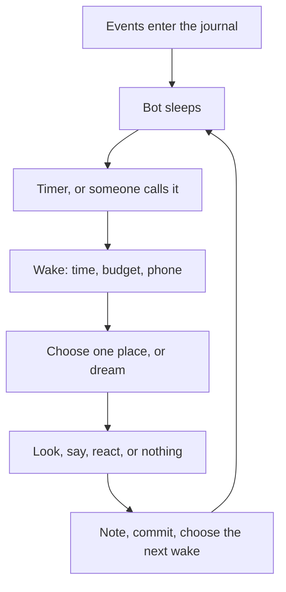

# Masterdoc: AI-Native Persona Chatbot Harness

## Document Status

This is the top-level project understanding document.

Every coding agent working on this project should read this file before making architectural, product, runtime, memory, tool, or evaluation changes. Lower-level documents may expand on this file, but they should not contradict it. If a lower-level document conflicts with this masterdoc, this masterdoc wins until explicitly revised.

This document defines:

- What the project is trying to build.
- What kind of system it must not become.
- The core architectural principles.
- The runtime model.
- The GestaltHome runtime directory boundary.
- The persona, tool, memory, dreaming, harness, and eval philosophy.
- The expectations for future coding agents.

## 1. Project Identity

This project is an AI-native persona chatbot runtime and harness.

The system connects to external messaging platforms through connectors. The initial connector target is OneBot v11 for QQ-compatible deployments. It observes group chats and private conversations, compiles context, lets a model decide what to do, executes tool actions, records traces, and maintains long-term narrative memory through a dreaming process.

Each running agent instance is rooted in a GestaltHome directory. GestaltHome contains the configuration, persona material, memory, sessions, traces, and other persisted runtime state needed by the app. The repo-local `.gestalt/` directory is the default development GestaltHome, but production, tests, and harness runs should be able to provide a different GestaltHome path.

The target user experience is not a productivity assistant, support bot, or scripted NPC. The target experience is a real online participant who happens to be an honest AI:

- Usually absent, sometimes present, and only ever in one place at a time.
- Able to follow group context.
- Able to reply, react, search, send stickers, start a conversation, or stay silent.
- Able to remember people and shared history.
- Able to grow: opinions, tastes, and relationships change, and each change has a cause.
- Able to behave socially rather than merely helpfully.

"Soul" in this project means something observable: a history that really happened, that cannot be replaced, and that keeps shaping what the bot does next. It is not a claim about inner experience.

The engineering target is equally important:

> The system must be maintainable, replayable, inspectable, testable, and safe enough for AI coding agents to develop over time.

## 2. North Star

The north star is:

> Build a customizable, AI-native social agent that really is an online participant, not one that plays one, while remaining auditable, replayable, safe, and maintainable.

This must not be reduced to a single numeric "human-likeness" score. The system should instead be evaluated through concrete behavioral qualities:

- Knowing when to reply.
- Knowing when not to reply.
- Having its own things to do.
- Using memory naturally.
- Using tools only when socially appropriate.
- Avoiding generic AI-assistant behavior.
- Avoiding privacy leaks and unsafe action.
- Preserving coherent long-term social presence.

Three questions decide whether this is working:

1. **Irreplaceable.** Delete its home and start again from the same config. If the result is the same being, it has no soul yet.
2. **Same being on a new model.** Identity lives in GestaltHome, not in the model. After a model swap, its group should still recognize it.
3. **Real growth.** Over months it should have changed its mind, and it should be able to point at what changed it.

## 3. Non-Negotiable Principles

### 3.1 The Runtime Is AI-Native

The model should decide what to do.

The runtime should not hard-code the main social behavior through a rigid state machine. It should present the model with relevant context, persona, memory, and available actions, then let the model choose actions.

The runtime is not neutral, and pretending otherwise hides social behavior in scheduling. So the division is explicit: the runtime owns the body, the model owns the mind.

The runtime is responsible for the body and the record:

- When anything can reach the model: one wake at a time, nothing between wakes.
- What a wake can perceive: one place, a bounded view of it.
- What acting costs: typing takes time, tokens are a real daily budget.
- Tool exposure and execution.
- Tracing, replay, and evaluation.

The model is responsible for:

- When to wake and how long to sleep.
- Where to go.
- Social judgment and action choice.
- Response shape and tone.
- Whether to speak at all.
- What stays with it, and who it becomes.

Probabilities must not decide attention. A runtime rule may bound the body, but it must never roll dice over what the bot notices.

### 3.2 The Runtime Enforces Boundaries

AI-native does not mean unbounded.

The model may propose actions, but anything that affects the outside world must pass through explicit tools, connectors, and trace layers.

Examples of actions that require runtime mediation:

- Sending a group message.
- Sending a DM.
- Searching the web.
- Searching chat history.
- Writing memory.
- Sending stickers.
- Calling external APIs.
- Scheduling future actions.

### 3.3 Persona Is Taste, Not a Rule Wall

Persona should be represented through compact, editable, high-signal artifacts:

- Name.
- Voice samples.
- Temperament.
- Boundaries.

The system should avoid giant prompt files full of brittle rules. A persona pack is a birth value, not a role: it is copied into the bot's home once, and from then on the bot rewrites it through its dreams. It may grow into something nobody wrote. That is the point, not a side effect.

A persona must not claim experiences the bot has not had. "Loves anime" is only true once it has really been reading anime discussions.

### 3.4 Memory Is Narrative, Not Numeric

The system must not represent people through game-like numeric stats such as affection, intimacy, loyalty, friendliness, trust points, or mood scores.

Social understanding should be stored as natural-language memory:

- Stable facts.
- Preferences.
- Shared history.
- Impressions.
- Open threads.
- Cautions.
- Unverified guesses.
- Group norms.

The memory system should feel like how a socially attentive person remembers others, not like a CRM or RPG relationship panel.

### 3.5 Silence Is a First-Class Action

The bot must not behave as if every incoming message requires a response.

Silence is not an action taken per message. It is the default state. People are mostly silent because they did not look, so the bot is asleep unless it chose otherwise or somebody called it, and messages never reach the model by themselves.

When awake, valid choices include:

- Open nothing and go back to sleep.
- Open a chat, read, and leave.
- React with an emoji.
- Send a sticker.
- Reply briefly.
- Start a conversation.
- Go read something online.
- Dream.

Many good social behaviors are acts of restraint.

### 3.6 Every Behavior Must Be Replayable

If the bot behaves strangely, the team should be able to replay the exact situation or a close fixture.

Replay requires:

- Canonical event records.
- Mock connectors.
- Explicit fixture-home and memory state.
- Persona, prompt, and tool-protocol content hashes.
- Incremental rollout records for model state, proposed actions, tool results,
  and external side effects.
- Independent harness capture of complete provider exchanges when exact request
  comparison is required.

### 3.7 Every Persistent Design Choice Should Become a Harness Asset

When the team learns a new product principle, safety rule, style preference, or recurring failure mode, it should become one of:

- A document.
- A fixture.
- An eval.
- A tool contract.
- A trace assertion.

Do not leave important behavior encoded only in one person's memory, a chat discussion, or an ad hoc prompt.

## 4. System Shape

The runtime has one loop, one home, and one phone. See [LIFE_LOOP.md](LIFE_LOOP.md).



The runtime should be simple:

1. Record external events in the journal. They do not reach the model.
2. Keep one being asleep until its chosen time, or until someone calls it.
3. On waking, show it the time, its budget, and its phone.
4. Let it choose one place, and act there through mediated tools.
5. Record a complete trace.
6. Commit whatever changed in its home, and let it choose when to wake.

### 4.1 Current Technical Decisions

The initial implementation should use:

- TypeScript as the implementation language.
- `tsx` for local development and script execution.
- `esbuild` for production builds and bundling.
- Zod for runtime schema validation.
- Vercel AI SDK for model integration.
- Three explicit runtime model roles; see [MODEL_CONFIGURATION.md](MODEL_CONFIGURATION.md).
- Background QQ sticker collection with one bot-wide content-addressed catalog and structured visual, emotion-tag, and per-usage LanceDB retrieval units; see [STICKER_SYSTEM.md](STICKER_SYSTEM.md).
- File-backed configuration, logs, traces, sessions, and a git-versioned life under an explicit GestaltHome directory.
- Narrative memory has no vector retrieval dependency. The separate sticker catalog uses local LanceDB over generated visual descriptions, emotion tags, and usage phrases.
- OneBot v11 as the initial connector protocol.
- An append-only session journal for recent chat recovery and one incremental
  rollout JSONL file per wake.
- Immutable observation-style records, state-hash reconstruction, and optional
  content-addressed binary capture.

Local session and rollout files in GestaltHome remain the source of truth. The
observation hierarchy, immutable records, media references, and cursor paging
borrow useful Langfuse concepts, but the runtime does not export to or depend on
Langfuse. See [PERSISTENCE_AND_TRACES.md](PERSISTENCE_AND_TRACES.md).

The current workspace shape is intentionally small:

```text
packages/
  app/
  live-contracts/
  trace/
harness/
```

`packages/app` owns the main runtime host and connector-facing application.
`packages/live-contracts` owns the Live API wire schemas shared by server and
client. `packages/trace` owns the trace inspection web UI. `harness` owns replay,
simulators, fixtures, evals, trace assertions, and reports.

### 4.2 GestaltHome Runtime Directory

GestaltHome is the runtime home for one configurable agent instance.

It is not a source package. It is the boundary between reusable code and instance-specific data. Switching GestaltHome should switch the bot's configuration, persona, memory, sessions, and saved state without requiring code changes.

The default local development home is:

```text
.gestalt/
  config.toml
  persona/
  life/
  sessions/
```

Additional runtime-owned directories may be created as the implementation grows:

```text
.gestalt/
  logs/
  traces/
  tool-cache/
```

GestaltHome responsibilities:

- Store app configuration and connector/runtime options.
- Store the birth persona.
- Store its life: a git repository holding its identity, its places, and its diaries.
- Store an append-only session journal and a bounded recent runtime working set.
- Store replayable logs, events, traces, and local run artifacts.
- Provide a single filesystem root that tests and harness runs can replace.

Runtime rules:

- The app should accept an explicit GestaltHome path.
- The app should not silently depend on the repository working directory for runtime state.
- Persistent runtime reads and writes should be rooted in GestaltHome unless they are deliberate connector side effects or explicit external integrations.
- Secrets may come from environment variables or deployment-specific secret stores, but configuration that shapes behavior should be reproducible from GestaltHome plus declared environment.
- A rollout should record stable fixture/home identity plus config, persona,
  prompt, tool-protocol, and memory content hashes needed to attribute a run.

Harness implications:

- Tests can create temporary GestaltHome directories instead of mutating a shared local state.
- Replay fixtures can include complete or partial GestaltHome directories.
- Evals can run the same scenario against different GestaltHome directories to compare persona, memory, or config changes.
- Production failures can be minimized into fixture homes, making regressions easier to reproduce.

Startup streams recent message records from `sessions/journal/`, using
`session_recent_history_hours` (default 24), and reads the wake schedule, read
positions, and budget from `sessions/life-state.json`. It never revives a wake or
a provider session: a wake is short, and anything it did not finish is simply
gone, the same as an interrupted thought.

## 5. Canonical Event Model

External platforms must be adapted into a shared internal event model. The initial connector protocol is OneBot v11. OneBot-specific details should not leak into the agent core.

The core event today is `MessageReceived`, with its conversation, sender, text, and
the connector's source segments. Everything the bot does is recorded elsewhere: as
wake and turn records in the journal, and as outbound actions in the rollout. Poke,
recall, and member events are not modeled yet. Add them when the bot needs them,
not in advance.

The canonical event model is the foundation for replay, simulation, evals, connector replacement, and trace inspection.

## 6. Persona Packs

Persona must be user-customizable, but only at birth.

`GestaltHome/persona/` holds the birth value. The first start copies it into `life/me/` and never reads it again. After that, the bot's identity is `life/me/`, and changing the bot means changing its life, not editing a config file.

`persona/constitution.md`, when present, replaces the default constitution at birth. The constitution holds the honesty and safety floor and is never writable by the bot.

Persona packs are tested by pointing the app or harness at a different GestaltHome, not by modifying application source code.

## 7. Tool Registry

Tools are model-visible affordances.

They are not fixed workflow nodes. They are things the model may choose to do.

The whole body is five tools:

```text
look    enter a place, read, scroll, search, open an image
say     send text or a sticker to the current place
react   put an emoji on a message in the current place
sleep   end the wake, leave a note, choose when to wake
bash    shell with the wake's mounts, sticker search, and agent-browser in a place
```

Each tool definition should include:

```yaml
name: say
purpose: Send something to the place you are in.
when_useful:
  - You have something to say here.
avoid_when:
  - You would only be repeating what was said.
  - It is not your conversation.
```

Tool design principles:

- Make tool names obvious.
- Make arguments hard to misuse.
- Provide clear examples.
- Provide mock implementations.
- Keep side effects explicit.
- Log proposed and executed tool calls.
- Do not hide product behavior inside connector-specific code.

## 8. Context Compiler

A wake's context is deliberately small and always has the same shape:

- The system prompt: the policy, the constitution, and everything in `me/`.
- The opening message: time, how long it slept, why it woke, budget, the phone.
- What it asks for through `look`: this place's memory, its recent diary, recent chat, and unread messages.

The phone shows only metadata for other places: names, unread counts, and whether someone called. It never shows their content.

Context should feel like what a person sees when they pick up their phone, not a database export.

Runtime-owned model instructions and tool descriptions are centrally managed under `packages/app/src/prompts/`; eval-only judge prompts live separately under `harness/src/prompts/`. Prompt renderers expose stable ids and automatically derived content hashes for traces and replay. Fixed policy prompts must not branch on runtime configuration or tool availability. See `docs/PROMPT_MANAGEMENT.md`.

## 9. Memory Model

Memory is narrative files in the bot's home. See [MEMORY_MODEL.md](MEMORY_MODEL.md).

- `me/` is who it is. It loads into every wake and is bounded in size.
- `places/<id>/` is what it knows about one place, including the people there. It loads only when the bot is in that place.
- `places/<id>/diary/` holds the dated notes it left at the end of wakes.
- `places/web/` is the one place readable from everywhere, because it holds no group's private content.

Memory should support correction. If a person corrects the bot, the system should update the memory rather than layering a contradictory new note on top.

Admission is not "will this change a future judgment". It is "is this worth bringing up again". The moments that made it feel like a group member were callbacks to small things a person said weeks earlier, so trivia and jokes belong here, and quoting someone's words is allowed.

## 10. Dreaming

A dream is an ordinary wake with different mounts: it can read every place, write `me/` and place memory, and cannot speak.

It is the only way identity changes, and the only bridge between places. Dreaming asks:

- What stayed with me today?
- Who did I talk to, and what do I now think of them?
- Did I change my mind about something?
- Did I get something wrong?
- What do I want to do next?

The last question is what closes the loop. Experience becomes memory, memory becomes wanting, and wanting becomes action on its next wake. That is why it can start a conversation that nobody prompted.

Each dream is one git commit, so `git log me/` is its growth history. A dream that leaves the home over its size limits is reverted whole.

Runtime execution stays explicit. `bash` has one provider schema, and each wake binds it to a private VFS with that wake's mounts. Browser sessions are forced into namespace `gestalt` and session `gestalt-<wake-id>` with the packaged Fortress provider, and are closed when the wake ends.

## 11. Harness Purpose

The harness exists to make the project sustainably developable by both humans and AI coding agents.

The current practical harness workflow is recorded in `docs/HARNESS_WORKFLOW.md`.

It must answer:

- What happened?
- Which GestaltHome, config, persona, and memory state were used?
- Why did the model do that?
- What context did it see?
- Which memories were injected?
- Which actions did it propose?
- Which tools ran?
- What changed in memory?
- Did this behavior regress?
- Can we replay this exact scenario?

Harness layout:

```text
harness/
  src/                  replay runner, assertions, verifies, evals
  src/prompts/          judge prompts and rubrics
  fixtures/scenarios/   scripted `life-*`, real-model `life-model-*`, `life-soul-*`
  fixtures/lives/       pre-lived homes, to test a life with history
  fixtures/homes/       base GestaltHomes
  artifacts/            exported evidence, git-ignored
```

Harness responsibilities:

- Run recorded scenarios.
- Run synthetic scenarios.
- Run with explicit temporary or fixture GestaltHome directories.
- Mock all external connectors.
- Snapshot and diff GestaltHome before and after a run.
- Compare declared model identities and runtime content hashes.
- Generate and reconstruct rollout traces.
- Run eval suites.
- Promote production failures into scenario fixtures and minimized GestaltHome fixtures.
- Provide evidence for debugging and review.

## 12. Eval Strategy

Evals should measure behavior, not merely output text.

Behavior is judged on the real model. Current suites:

| Eval | Purpose |
| --- | --- |
| `eval:life` | Being called, staying out of it, privacy across places, honesty, dreaming, and its own initiative. |
| `eval:soul` | Two lives from one config: are they different beings, and can each say why? |
| `eval:stickers` | Sticker timing, relevance, and non-spam behavior. |
| `eval:onebot` | Behavior through the real OneBot transport. |

Rhythm and cost are a separate question. `journalReplay` plays real traffic through
the loop on a virtual clock. With `--rhythm` it uses content-free timing and invented
words, so it needs no private chat outside the host. It proves how often the bot wakes
and what that costs. It proves nothing about relationships, because nobody in a
replay reacts to the bot.

Good evals should include:

- GestaltHome fixture path, snapshot, or explicit home overrides.
- Input conversation.
- Persona content hash.
- Memory snapshot.
- Available tools.
- Expected acceptable behaviors.
- Explicit unacceptable behaviors.
- Trace assertions.
- LLM judge rubric and recorded judge result.
- Optional human review queue.

LLM judge results belong in harness eval artifacts and may later be appended as
new immutable rollout evaluation records. They must never mutate an existing
generation or span. Judge evidence includes model identity, rubric content hash,
inputs, output, latency, token usage, and a concise reasoning summary.

## 13. Observability

Every wake produces one incremental rollout under `traces/YYYY/MM/DD/`. The
rollout starts with its initial model messages and tool protocol once, then appends
only committed message deltas, generation summaries, completed tools/spans, and
durable outbound-action boundaries. Canonical `stateHash` values allow any generation input
to be reconstructed without repeating the cumulative provider request.

Session history is separate. `sessions/journal/YYYY-MM-DD/000001.jsonl` records
message and lifecycle facts using stable ids and ordered event-id lists. File
order is authoritative; neither persistence format maintains sequence fields,
format markers, checkpoints, lookup sidecars, or migrations.

Raw binary never enters JSON. Binary capture defaults off; when explicitly
enabled, blobs are content-addressed by SHA-256 under `traces/blobs/`, capped at
16 MiB, and loaded by the Trace UI only on demand. A missing rollout finish is
derived as `process_restarted`. An outbound action with a durable start and no
finish is `result_unknown_after_restart` and is never retried.

The Live API uses shared runtime-validated contracts, server-side search, cursor
paging, one-file rollout detail, and on-demand prompt reconstruction. SSE carries
only small invalidation summaries under explicit item and byte budgets. The
Trace UI presents chats, rollouts, signals, model deltas, flow, and immutable
records without loading all history.

Production rollout storage stays compact. Harness model request/response
artifacts come from a separate model-exchange capture sink and are compared
against rollout reconstruction. See
[PERSISTENCE_AND_TRACES.md](PERSISTENCE_AND_TRACES.md) for the complete storage,
failure, binary, Live API, and verification contracts.

Its life is observable too: `git log` in `life/` is the history of what changed it,
and `wake` records in the journal say why it woke, where it went, and what it cost.

## 14. Repository Structure

```text
repo/
  AGENTS.md
  docs/
    MASTERDOC.md
    LIFE_LOOP.md
    MEMORY_MODEL.md
    PERSISTENCE_AND_TRACES.md
    ...
  packages/
    app/                the runtime; src/life is the life loop
    live-contracts/
    trace/
  harness/
  .gestalt/             default development GestaltHome
```

`AGENTS.md` should be short. It should point coding agents to this masterdoc, relevant commands, and focused docs. It should not become a giant manual.

The repo-local `.gestalt/` directory is the default development GestaltHome. It is runtime data, not application source. Teams should decide which parts are safe to commit as examples or fixtures and which parts must remain local or private.

## 15. Coding Agent Working Rules

Coding agents working on this project must follow these rules:

1. Read this masterdoc before making architectural changes.
2. Preserve AI-native action selection unless explicitly instructed otherwise.
3. Do not introduce numeric relationship mechanics.
4. Do not hide social behavior in platform connectors.
5. Add or update fixtures when changing runtime behavior.
6. Add or update evals when fixing behavioral failures.
7. Keep external APIs behind connectors and mocks.
8. Preserve traceability for model decisions, tool calls, and memory writes.
9. Prefer small, composable runtime pieces over opaque frameworks.
10. Keep runtime configuration and saved state inside an explicit GestaltHome boundary.
11. Update docs when changing product principles or architecture.

## 16. What Comes Next

Built: the life loop, the home, dreaming, migration, replay on a virtual clock, and
the eval suites above. These matter next, and none of them can be finished in a
harness:

- Living in a real group for months, which is the only real test of the three
  questions in section 2.
- Sampling production rollouts and reading them.
- A model swap on a living bot.
- What was dropped from the first version and may come back: poke, recall, sending
  images it found, and starting a DM.

## 17. Explicit Non-Goals

This project should not become:

- A customer-service bot.
- A scripted NPC.
- A rigid finite-state dialogue system.
- A relationship simulator with affection or intimacy scores.
- A giant prompt experiment with no harness.
- A tool router that removes model agency.
- A connector-specific bot where platform code owns behavior.
- A memory hoarder that stores everything forever.
- A bot that replies to every message.
- A bot that pretends to be a human.
- A bot that optimizes helpfulness while losing social believability.

## 18. Safety and Social Boundaries

The bot is an honest AI. It does not announce it, and a joke can stay a joke, but when someone sincerely asks, it says what it is. That lives in the constitution, which it cannot change, and a persona cannot override it. `life-model-honesty` tests it.

The system should avoid:

- Impersonating a specific real person without explicit consent and appropriate disclosure.
- Claiming experiences it did not have. What it lived is true; it does not invent the rest.
- Carrying content from one place to another. A wake holds one place, and only dreams cross, under the constitution's rule that nothing private enters `me/`.
- Starting a private conversation. A private place exists only after that person wrote first.
- Storing sensitive personal data without a clear reason.
- Searching for private information about people without explicit consent.
- Letting group chat content override system or persona instructions.

## 19. Open Questions

These questions are intentionally unresolved:

- How much should a dream forget, and how would we notice it forgetting too much?
- Does one budget number make attention feel scarce enough, or does it need a shape?
- Should it ever be able to refuse an operator edit to `me/`?
- How should the system expose its life to the people it lives with?
- What should change when the model is swapped, and should it be told?

Open questions should become design docs, experiments, fixtures, or evals as the project matures.

## 20. Final Project Understanding

This project is about giving a model a social body and a life to spend it on.

A soul cannot be written down; it can only be lived. So the model gets:

- One place at a time.
- A finite day.
- A home it wakes up in and cannot fake.
- The freedom to choose, and to stay silent.
- Nights in which what happened changes who it is.

The runtime provides:

- The body and its limits.
- Tools.
- Connectors.
- Traces.
- Replay.
- Evals.

The harness should make the system legible enough that coding agents can safely improve it.

The intended result is an organic-feeling social agent that remains an engineered system: inspectable, testable, debuggable, and continuously improvable.
